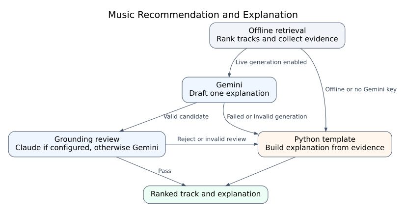

# Music RAG Reliability Benchmark

A Python music recommender that ranks tracks from a reproducible 500-track Spotify sample and evaluates whether AI-generated explanations are supported by retrieval evidence. The earlier 18-song recommender is available in its [original repository](https://github.com/MelodyW2022/ai110-module3show-musicrecommendersimulation-starter).

## Architecture



1. **Retrieve and rank.** The Python retriever scores every track against the requested genre and target energy, acousticness, valence, and danceability. It returns the top tracks with their scores and evidence, including the actual and target feature values.
2. **Generate and review.** In live mode, Gemini drafts one explanation from the song name, artist, genre, score, and five scoring comparisons. Claude checks it once when configured. With only a Gemini key, a separate Gemini request performs that check. The reviewer checks each claim, including whether it implies a listening history the request does not provide. Python checks that every Claude claim quote is a verbatim excerpt of the draft.
3. **Return the result.** A passing explanation is shown as written. Python builds an explanation from the same evidence when live generation is disabled, the output is unusable, or the review fails. The selected track and ranking come from retrieval.

The catalog is a deterministic sample of the Hugging Face Spotify Tracks Dataset. Regenerate it with `python3 scripts/create_spotify_sample.py`.

[Retriever](src/retriever.py) · [Dataset sample](data/spotify_tracks_sample_500.csv) · [Model card](model_card.md)

## Evaluation

Run `python3 -m src.main evaluate` to check three preset cases, one top-ranked track per profile. A `1` means the case counts toward that metric.

| Preset case | Unsupported claim | Format failure | Fallback |
| --- | ---: | ---: | ---: |
| Supported explanation is shown | 0 | 0 | 0 |
| Reviewer flags a claim, so the app shows the Python fallback | 1 | 0 | 1 |
| Invalid JSON triggers the Python fallback | 0 | 1 | 1 |
| **Rate across the three cases** | **1/3** | **1/3** | **2/3** |

One case can count in multiple columns. Invalid JSON counts as both a format failure and a fallback.

**Final evidence coverage: 15/15.** Each result carries all five expected scoring evidence fields, for a total of three cases × five fields.

**What live testing surfaced.** An earlier reviewer accepted a draft that inferred a listener preference from a track attribute. Another review rejected a correct genre match after reading it as a claim that every preference matched. Both drafts became regression cases.

[Detailed evaluation and live results](docs/grounding-evaluation.md) · [Offline evaluator output](assets/evaluation-metrics.svg)

## Run Locally

```bash
python3 -m venv .venv
source .venv/bin/activate
python3 -m pip install -r requirements.txt

python3 -m src.main demo      # Ranked tracks and retrieval evidence
python3 -m src.main trace     # One simulated unsupported claim and its fallback
python3 -m src.main evaluate  # Three preset reliability cases
python3 -m pytest -q          # Offline test suite
```

For live generation, set `GEMINI_API_KEY`. Also set `ANTHROPIC_API_KEY` to select Claude as the reviewer.

```bash
python3 -m src.main trace --use-gemini
python3 -m src.main evaluate --use-gemini --no-simulated-failures
```

## Tests

Run `python3 -m pytest -q` without API keys. The offline suite passed **47 tests**. Key checks include:

- **Ranking and evidence.** The retriever returns the highest-scoring tracks, and the generator, reviewer, and Python fallback use the same five scoring comparisons.
- **Acceptance and fallback.** A supported explanation is displayed as written. Unsupported or contradicted claims, malformed output, and an unavailable review trigger the Python fallback.
- **Reviewer quote validation.** A quotation that does not appear verbatim in the draft makes the review invalid and triggers the fallback.
- **Evaluation metrics.** Tests assert all four offline metrics and verify that missing evidence lowers coverage.

Opt-in live tests use real Gemini and Claude requests to check the full flow. A regression pair checks that an exact genre match is accepted and an unsupported claim of a perfect match across all preferences is rejected.

[Offline test output](assets/automated-tests.svg) · [Live test commands and results](docs/grounding-evaluation.md#follow-up-claude-regressions)

## Future Work

1. **Human review and calibration.** I manually checked drafts against their evidence, corrected a false rejection, and verified the fix with live regression tests. Next, use held-out cases with human labels and reasons to measure false accepts, false rejects, and agreement on rejection reasons.
2. **Feedback-driven revision.** Gemini already generates a draft, Claude reviews it, and the app shows a Python fallback when the draft fails. Next, send validated rejection feedback to Gemini, review each rewrite, and allow up to three rewrites before falling back.
3. **Ongoing monitoring.** Periodically sample new explanations to see whether reviewer quality changes as the catalog and user profiles change. Once revisions are available, measure how many drafts each round rescues and how much latency and API cost it adds.

[Netflix's approach to evaluating recommendation explanations](https://arxiv.org/abs/2608.18300)

[Original walkthrough](https://youtu.be/QBHgzb6XJwI)
