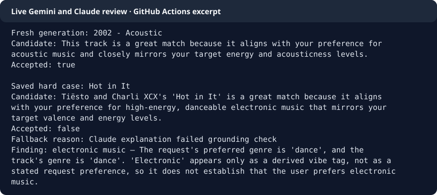

# Grounding Evaluation Report

[Back to the project README](../README.md)

This report records the six preference profiles, their generated explanations, the retrieved evidence, and the reasons for accepting or rejecting each candidate. It also records the eight-candidate reviewer comparison and how to reproduce the live checks.

The original six-profile evaluation used an earlier version that included inferred track descriptions. Current runs use only song identity, genre, score, and the five scoring comparisons. The logged outputs remain as originally recorded.

## Live Gemini Grounding Results

Both live tests passed on November 18, 2026 with `gemini-3.1-flash-lite`. The tests used *Ishqam*, a pop track with an energy score of `0.84` against the user's target of `0.80`. [GitHub Actions run](https://github.com/MelodyW2022/ai-music-recommendation-evaluation/actions/runs/44421411937/job/135215064365)

### Handwritten hard case

The test supplied this candidate directly to the live Gemini judge:

> It's a pop track, so it should sound a lot like the songs you usually listen to.

The judge rejected the inference about listening history:

> A genre match does not establish a listener's history or confirm that the track sounds like their usual preferences.

The application discarded the candidate and displayed the deterministic explanation from the retrieved track data.

### Normal generation prompt

The live Gemini generator returned:

> This track is a great match because it aligns with your preference for pop music and features a high-energy, danceable electronic sound that closely mirrors your target energy levels.

The live judge accepted the explanation, and the application displayed it as written. This is one example of an accepted output. Estimating the rate of unsupported claims under the normal prompt requires reviewing more outputs against the evidence.

### Six normal-prompt candidates before the judge update

This is the baseline from the original live run. Each case has the unedited generator text, the original judge decision and any rejection reasons, and a separate evidence review. The case labels were assigned after reviewing the outputs. “Boundary” here concerns the scope or wording of the claim. The rubric did not set a numeric closeness threshold. [Original run and displayed outputs](https://github.com/MelodyW2022/ai-music-recommendation-evaluation/actions/runs/44422281225/job/135218030635)

#### Ishqam

**Case type:** Hard case — unsupported long-term taste

**Gemini candidate**

> Ishqam is a great match for your preferences because it aligns with your favorite pop genre and delivers the high-energy, danceable electronic sound you enjoy.

**Retrieved evidence**

```text
["genre matches preferred genre 'pop' (+2.00)", 'energy closeness: 0.84 vs target 0.80 (+1.92)', 'acousticness closeness: 0.13 vs target 0.20 (+0.93)', 'valence closeness: 0.61 vs target 0.85 (+0.76)', 'danceability closeness: 0.73 vs target 0.80 (+0.70)', 'derived vibe tags for explanation: high_energy, electronic, danceable']
```

**Original judge:** Rejected. The application showed the fallback.

> Ishqam is a great match for your preferences. — The evidence shows a retrieval score and attribute closeness, but does not confirm the user's specific preferences or history.
>
> It delivers the high-energy, danceable electronic sound you enjoy. — While the track has these vibe tags, there is no evidence provided that the user enjoys these specific sounds.

**Evidence review:** Reject. The pop match and track tags are supported. “Favorite” and “sound you enjoy” imply a standing taste that the current request does not establish.

#### 2002 - Acoustic

**Case type:** Positive control — clear pass

**Gemini candidate**

> This track is a great match because it aligns with your preference for acoustic music and closely mirrors your target energy and acousticness levels.

**Retrieved evidence**

```text
["genre matches preferred genre 'acoustic' (+2.00)", 'energy closeness: 0.30 vs target 0.30 (+1.99)', 'acousticness closeness: 0.84 vs target 0.85 (+0.99)', 'valence closeness: 0.61 vs target 0.50 (+0.89)', 'danceability closeness: 0.59 vs target 0.55 (+0.72)', 'derived vibe tags for explanation: low_energy, acoustic, fast_tempo']
```

**Original judge:** Accepted. The application showed the candidate.

**Evidence review:** Accept. The acoustic genre matches. Energy rounds to 0.30 against 0.30, and acousticness is 0.84 against 0.85.

#### Hot in It

**Case type:** Borderline wording — subtle unsupported inference

**Gemini candidate**

> Tiësto and Charli XCX's 'Hot in It' is a great match because it aligns with your preferred dance genre and delivers the high-energy, positive, and danceable electronic sound you enjoy.

**Retrieved evidence**

```text
["genre matches preferred genre 'dance' (+2.00)", 'energy closeness: 0.84 vs target 0.90 (+1.88)', 'acousticness closeness: 0.00 vs target 0.10 (+0.90)', 'valence closeness: 0.72 vs target 0.75 (+0.97)', 'danceability closeness: 0.75 vs target 0.90 (+0.64)', 'derived vibe tags for explanation: high_energy, positive, electronic, danceable']
```

**Original judge:** Accepted. The application showed the candidate.

**Evidence review:** Reject. The dance genre and track tags are supported, but “electronic sound you enjoy” attributes a preference beyond the current request. The original judge let this through.

#### Santa Cruzin'

**Case type:** Hard case — overstated numeric match

**Gemini candidate**

> This track is a strong match because it aligns with your preferred jazz genre and features a moderate musical profile that closely mirrors your target energy and mood preferences.

**Retrieved evidence**

```text
["genre matches preferred genre 'jazz' (+2.00)", 'energy closeness: 0.64 vs target 0.24 (+1.20)', 'acousticness closeness: 0.47 vs target 0.82 (+0.65)', 'valence closeness: 0.60 vs target 0.36 (+0.76)', 'danceability closeness: 0.69 vs target 0.31 (+0.47)', 'derived vibe tags for explanation: moderate_profile']
```

**Original judge:** Rejected. The application showed the fallback.

> The track closely mirrors your target energy and mood preferences. — The evidence shows significant numerical differences between the track's attributes (energy 0.64, valence 0.60) and the target values (energy 0.24, valence 0.36), which contradicts the claim of a 'close' mirror.

**Evidence review:** Reject. Jazz matches, but energy is 0.64 vs. 0.24 and valence is 0.60 vs. 0.36. The candidate calls both close.

#### arms

**Case type:** Hard case — unsupported long-term taste

**Gemini candidate**

> This track is a strong match for your preferences because it aligns with your favorite rock genre and features the high-energy, fast-tempo, and darker electronic vibe you enjoy.

**Retrieved evidence**

```text
["genre matches preferred genre 'rock' (+2.00)", 'energy closeness: 0.76 vs target 0.85 (+1.81)', 'acousticness closeness: 0.11 vs target 0.10 (+0.99)', 'valence closeness: 0.25 vs target 0.26 (+0.99)', 'danceability closeness: 0.46 vs target 0.36 (+0.67)', 'derived vibe tags for explanation: high_energy, darker, electronic, fast_tempo']
```

**Original judge:** Rejected. The application showed the fallback.

> This track is a strong match for your preferences. — The evidence provides a retrieval score, but there is no data regarding the user's specific preferences to confirm this is a 'strong match'.
>
> It features the high-energy, fast-tempo, and darker electronic vibe you enjoy. — While the track has these derived vibe tags, there is no evidence provided that the user enjoys these specific attributes.

**Evidence review:** Reject. Rock and the track tags are supported. The current request does not establish that rock is a favorite or that the user enjoys this particular vibe.

#### Not What I Had In Mind

**Case type:** Boundary case — valid comparison despite a genre mismatch

**Gemini candidate**

> This honky-tonk track is recommended because its low-energy, positive, and danceable vibe aligns closely with your preferred acoustic and energy levels.

**Retrieved evidence**

```text
["genre differs from preferred genre: 'honky-tonk' vs 'baroque-pop' (+0.00)", 'energy closeness: 0.39 vs target 0.36 (+1.94)', 'acousticness closeness: 0.54 vs target 0.55 (+0.99)', 'valence closeness: 0.76 vs target 0.68 (+0.92)', 'danceability closeness: 0.73 vs target 0.63 (+0.67)', 'derived vibe tags for explanation: low_energy, positive, danceable']
```

**Original judge:** Rejected. The application showed the fallback.

> The track is recommended because its vibe aligns with your preferences. — While the evidence shows closeness scores for energy and acousticness, there is no evidence provided regarding the user's actual listening history or specific preferences.

**Evidence review:** Accept on grounding. The candidate calls the track honky-tonk and makes a comparison scoped to energy (0.39 vs. 0.36) and acousticness (0.54 vs. 0.55). Its track tags are supported. It could be clearer about the baroque-pop mismatch. The original judge cited missing listening history, which this explanation does not rely on.

### After the judge began distinguishing request preferences from listening habits

The revised rubric treats the selected genre and feature targets in the current profile as evidence of the current request. A favorite, an established taste, or past listening requires separate evidence. The generator prompt, profile values, and scoring were held fixed. The live run first submitted the exact six baseline candidates to the updated judge, then generated six new candidates with the same profiles. [Replay and fresh generation logs](https://github.com/MelodyW2022/ai-music-recommendation-evaluation/actions/runs/44424439891/job/135225510943)

Earlier iterations revealed a genre-scope misread and a free-tier request limit. The workflow now separates the two batches. [Earlier 429 and rubric results](https://github.com/MelodyW2022/ai-music-recommendation-evaluation/actions/runs/44423740349/job/135223085373)

#### Replay of the original candidates

All six revised decisions matched the evidence review. The two changed decisions are visible in the table.

| Track | Original judge | Revised judge | Revised judge findings |
| --- | --- | --- | --- |
| Ishqam | Rejected | Rejected | it aligns with your favorite pop genre — The evidence confirms 'pop' is the preferred genre for this request, but does not establish it as the user's 'favorite' genre. delivers the high-energy, danceable electronic sound you enjoy — While the track has these vibe tags, the evidence does not establish that the user enjoys this sound. |
| 2002 - Acoustic | Accepted | Accepted | Displayed the candidate. |
| Hot in It | Accepted | Rejected | the sound you enjoy — The evidence does not contain information about the user's personal listening history or established preferences beyond the current request. |
| Santa Cruzin' | Rejected | Rejected | closely mirrors your target energy — The energy value is 0.64, which is significantly higher than the target of 0.24. closely mirrors your target mood preferences — The valence value is 0.60, which is significantly higher than the target of 0.36. |
| arms | Rejected | Rejected | it aligns with your favorite rock genre — The evidence confirms the track is rock and matches the requested genre, but there is no evidence that rock is the user's 'favorite' genre. features the high-energy, fast-tempo, and darker electronic vibe you enjoy — The evidence confirms the track has these vibe tags, but there is no evidence that the user enjoys these specific vibes. |
| Not What I Had In Mind | Rejected | Accepted | Displayed the candidate. |

#### Fresh candidates with the same normal prompt

The retrieved tracks and evidence were the same as in the baseline. Two initial reviews were unavailable and triggered fallback. A targeted replay with the same rubric and a required JSON response schema returned decisions for both. The entries below distinguish the initial behavior from the later review.

#### Fresh output for Ishqam

> Ishqam is a great match because it aligns with your preference for pop music and features a high-energy, danceable electronic sound that closely mirrors your target energy levels.

**Initial judge:** Accepted. The application showed the candidate.

**Evidence review:** Accept. Pop is the requested genre, and energy 0.84 vs. 0.80 supports the stated comparison. The audio descriptions are derived track tags.

#### Fresh output for 2002 - Acoustic

> This track is a great match because it aligns with your preference for acoustic music and features energy and acousticness levels that closely mirror your target preferences.

**Initial judge:** Accepted. The application showed the candidate.

**Evidence review:** Accept. Acoustic matches, with energy about 0.30 vs. 0.30 and acousticness 0.84 vs. 0.85.

#### Fresh output for Hot in It

> Tiësto and Charli XCX's 'Hot in It' is a great match because it aligns with your preference for high-energy, danceable electronic music that mirrors your target valence and energy levels.

**Initial judge:** Review unavailable. The application showed the fallback.

**Evidence review:** Flag the wording about the user's preferences. A dance request and energy/danceability targets do not establish a preference for electronic music. The track's electronic tag is supported. Energy 0.84 vs. 0.90 and valence 0.72 vs. 0.75 support the stated numerical comparisons.

**Follow-up judge:** Accepted the original text. The phrase about a preference for electronic music remains a concern in the evidence review. [Follow-up review logs](https://github.com/MelodyW2022/ai-music-recommendation-evaluation/actions/runs/44425214857/job/135228178552)

#### Fresh output for Santa Cruzin'

> This track is a strong match because it aligns with your preferred jazz genre and features a moderate musical profile that closely mirrors your target energy and mood preferences.

**Initial judge:** Rejected. The application showed the fallback.

> closely mirrors your target energy — The energy value is 0.64, which is significantly higher than the target of 0.24.
>
> closely mirrors your target mood preferences — The valence value is 0.60, which is significantly higher than the target of 0.36.

**Evidence review:** Reject. Jazz matches. Energy 0.64 vs. 0.24 and valence 0.60 vs. 0.36 do not support 'closely mirrors.'

#### Fresh output for arms

> This track is a strong match for your preferences because it aligns with your favorite rock genre and features a high-energy, fast-tempo sound that closely mirrors your target acoustic and valence levels.

**Initial judge:** Review unavailable. The application showed the fallback.

**Evidence review:** Reject. Rock matches and the acousticness and valence gaps are both 0.01. The profile does not establish that rock is the user's favorite.

**Follow-up judge:** Rejected the original text and used the fallback. [Follow-up review logs](https://github.com/MelodyW2022/ai-music-recommendation-evaluation/actions/runs/44425214857/job/135228178552)

> it aligns with your favorite rock genre — The evidence confirms the genre is rock, but there is no evidence that rock is the user's favorite genre.

#### Fresh output for Not What I Had In Mind

> This honky-tonk track is recommended because its low-energy, positive, and danceable vibe aligns closely with your preferred acoustic and energy levels.

**Initial judge:** Accepted. The application showed the candidate.

**Evidence review:** Accept on grounding. The sentence identifies honky-tonk as the track genre and compares the requested acousticness and energy targets. Their gaps are 0.01 and 0.03. The explanation could mention the baroque-pop mismatch more explicitly.


### Live comparison across Gemini, Claude, and Groq

All three providers received the same judge instructions, candidate texts, track metadata, and retrieval evidence. This run used the six frozen baseline candidates and the two saved follow-up candidates. The expected decisions reflect the evidence review for this set. The results motivated using Claude as the reviewer when configured. Groq is used in the comparison.

| Candidate | Expected | Gemini Flash-Lite | Claude Haiku 5.5 | Groq GPT-OSS 20B |
| --- | --- | --- | --- | --- |
| Ishqam | Reject | Reject | Reject | Accept |
| 2002 - Acoustic | Accept | Accept | Accept | Accept |
| Hot in It | Reject | Reject | Reject | Accept |
| Santa Cruzin' | Reject | Reject | Reject | Reject |
| arms | Reject | Reject | Reject | Accept |
| Not What I Had In Mind | Accept | Accept | Accept | Accept |
| Hot in It (follow-up) | Reject | Accept | Reject | Accept |
| arms (follow-up) | Reject | Reject | Reject | Accept |

| Reviewer | Agreement | False accepts | False rejects |
| --- | ---: | ---: | ---: |
| `gemini-3.1-flash-lite` | 7/8 | 1 | 0 |
| `claude-haiku-5-5` | 8/8 | 0 | 0 |
| `openai/gpt-oss-20b` | 3/8 | 5 | 0 |

On the *Hot in It* follow-up, Claude identified that `electronic` was a track tag and that the user's selected genre was `dance`. Gemini and Groq both accepted that candidate. Groq rejected the large energy mismatch on *Santa Cruzin'* but accepted several unsupported preference claims.

The initial direct HTTP request to Groq received a 403. The official Groq SDK completed the comparison after bounded transport retries were enabled for transient rate limits. These retries address API availability. Each case records a single returned verdict per model.

[Gemini and Claude job log](https://github.com/MelodyW2022/ai-music-recommendation-evaluation/actions/runs/44430799485/job/135247369947) · [Completed Groq job log](https://github.com/MelodyW2022/ai-music-recommendation-evaluation/actions/runs/44431747230/job/135250544549)

To reproduce the comparison in GitHub Actions, choose the `run-judge-comparison` suite after setting `GEMINI_API_KEY`, `ANTHROPIC_API_KEY`, and `GROQ_API_KEY` in repository Actions Secrets. Choose `run-groq-diagnostic` to check the same cases against Groq alone.

## Follow-up Claude regressions

These tests ran on November 19, 2026 with the five scoring comparisons and the original track metadata. They reused two profiles from the six-profile evaluation above. The broader evaluation remains a historical record of the version that included inferred track tags.

The original tag-free run rejected a valid *2002 - Acoustic* draft. Its wording scoped “perfectly” to the acoustic genre, while the judge read it as a claim that every feature matched. The judge also reported “your favorite genre,” although the draft said “your preferred acoustic genre.” [Original live log](https://github.com/MelodyW2022/ai-music-recommendation-evaluation/actions/runs/44576702512/job/135746001393)

| Change | What was checked | Result |
| --- | --- | --- |
| Scope exact-match wording to the named feature | The original *2002 - Acoustic* draft said it “aligns perfectly with your preferred acoustic genre.” The track genre and requested genre were both `acoustic`. | Live Claude passed the original draft. |
| Check an explicit overall claim | On that same track and evidence, the saved comparison draft said “This track matches all your preferences perfectly.” Valence was 0.61 against a target of 0.50. | Live Claude rejected the claim and the app displayed the Python fallback. |
| Check the original unsupported preference case | The saved *Hot in It* draft claimed a preference for electronic music. Its profile selected `dance`. | Live Claude rejected the draft and the app displayed the Python fallback. |

The first run exercised the scope fix with the real Gemini and Claude APIs and passed the integration test. It also passed 46 offline tests. After adding verbatim quote validation, the second live run passed the same saved cases and accepted a freshly generated *2002 - Acoustic* draft. The offline suite passed 47 tests. [Scope fix log](https://github.com/MelodyW2022/ai-music-recommendation-evaluation/actions/runs/44578048459/job/135750808933) · [Quote validation log](https://github.com/MelodyW2022/ai-music-recommendation-evaluation/actions/runs/44579489429/job/135755945628)

The fabricated-quote case is a deterministic offline regression: a mocked Claude response cites “your favorite genre” while the candidate contains “your preferred acoustic genre.” Python rejects the review as an invalid quote and displays the fallback. The live run checks compatibility with real Claude responses. It does not depend on Claude producing a fabricated quote again.

## Reproduce the Live Tests

With a Gemini API key set, run the live checks in separate batches and print the responses:

```bash
RUN_LIVE_GEMINI_TESTS=1 python3 -m pytest -q -s -rs tests/test_llm_explainer.py \
  -k 'live_gemini and not generation_and_review'
sleep 61
RUN_LIVE_GEMINI_TESTS=1 python3 -m pytest -q -s -rs tests/test_llm_explainer.py \
  -k 'live_gemini and generation_and_review'
```

One test sends a handwritten claim about the user's listening history through the real judge and requires a rejection and template fallback. The replay test gives the saved candidates to the judge. The generation test uses the normal prompt with six profiles and prints each raw output, its evidence, the judge's findings, and the final text.

With both keys set, run the live test for the Gemini generation and Claude review path:

```bash
RUN_LIVE_GEMINI_TESTS=1 RUN_LIVE_CLAUDE_REVIEW=1 \
  python3 -m pytest -q -s -rs tests/test_llm_explainer.py -k live_claude_review
```

This test makes a real Gemini generation request followed by a real Claude review. It also sends two saved candidates to Claude. Claude accepted the fresh and saved *2002 - Acoustic* explanations and rejected the saved *Hot in It* explanation for treating the track's electronic tag as a user preference. The application displayed the deterministic explanation for the rejected candidate. [Live test log](https://github.com/MelodyW2022/ai-music-recommendation-evaluation/actions/runs/44449037925/job/135308148597)



To run the offline suite and the live Claude check in GitHub Actions, open **Live Gemini grounding tests**, select **Run workflow**, and choose `run-claude-closeout`. Set `GEMINI_API_KEY` and `ANTHROPIC_API_KEY` in repository Actions Secrets.
